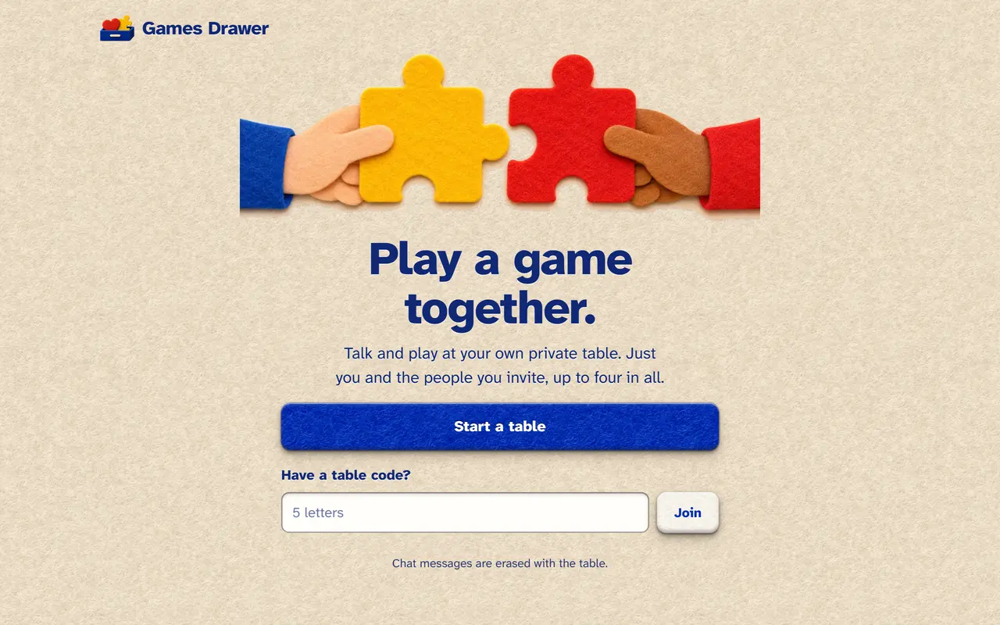
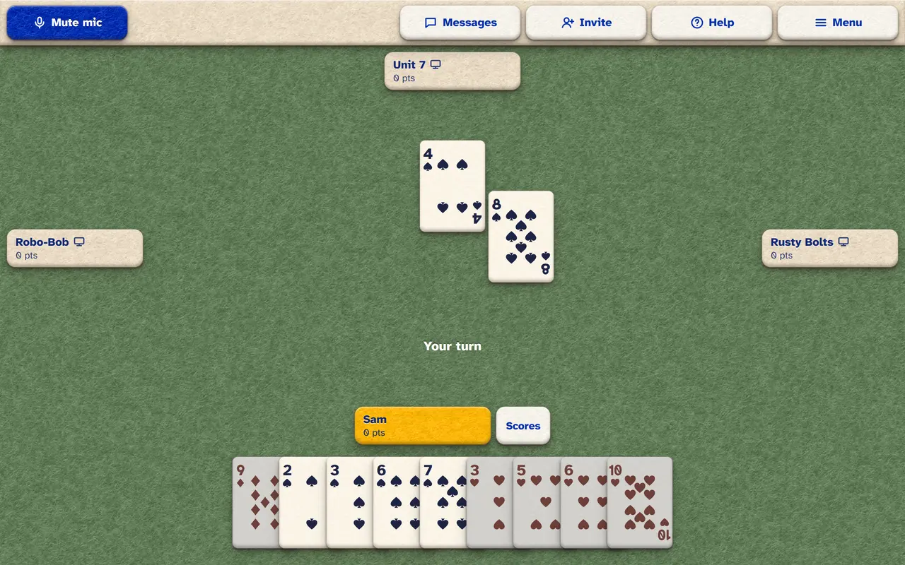
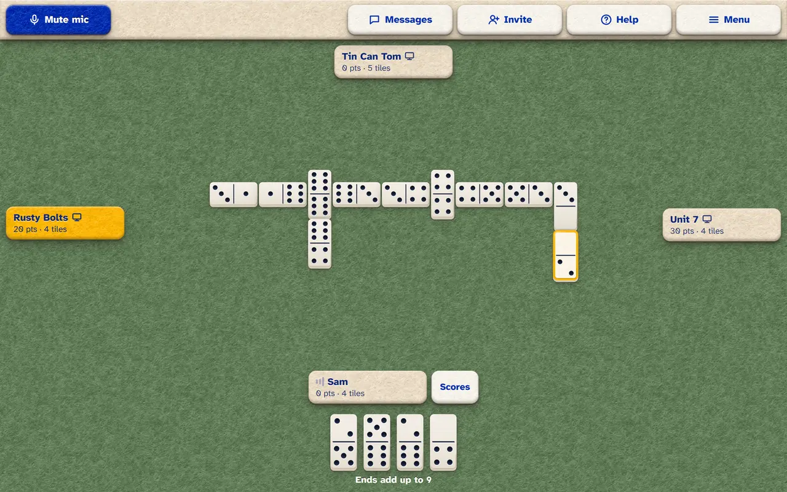
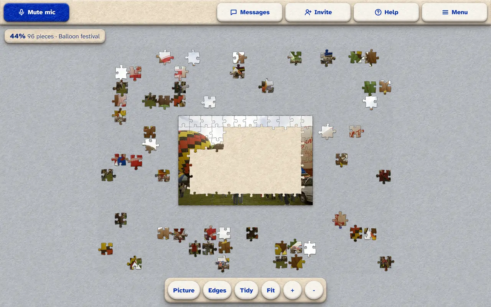
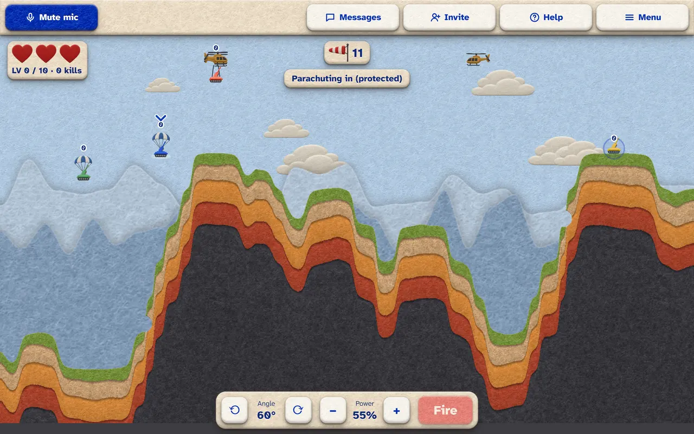

# Games Drawer

A place to hang out with family and friends and play small games together, with voice and text
chat that keep going from one game to the next. It's made for people who aren't technical (it
started as a way to play with a mom and a brother), so it works the same on a phone, a tablet
or a computer, with big buttons, plain words and nothing to install.

Six games so far: **Hearts**, **Spades**, **Dominoes** (All Fives), **Three Thirteen** (rummy in 11
rounds, with jokers), a co-op **Jigsaw** puzzle and **Tanks** ("Tank You For Being A Friend"), all
in a felt look, like a games table.



<table>
  <tr>
    <td></td>
    <td></td>
  </tr>
  <tr>
    <td align="center"><b>Hearts</b> (and Spades): you and up to three friends, computer players in any empty seats</td>
    <td align="center"><b>Dominoes</b>: All Fives, first to 250</td>
  </tr>
  <tr>
    <td></td>
    <td></td>
  </tr>
  <tr>
    <td align="center"><b>Jigsaw</b>: build it together, from 6 to 500 pieces, and pick it up again later</td>
    <td align="center"><b>Tanks</b>: angle, power, wind and fire</td>
  </tr>
</table>

## How a table works

1. **Start a table**: type your first name and choose the mic on or off. A game's own page
   (`/hearts`, `/dominoes`…) opens the table with that game already picked.
2. **Invite people**: a link (it says who sent it, and can name who it's for) or the table's
   five-letter code. Before joining, the join page says who's already at the table.
3. **Gather at the table**: talk, pick a game together (anyone can pick or change it), and for
   the card and tile games pick where you sit (Three Thirteen also picks how many play, 2 to 4).
4. **Play**: the game starts once everyone at the table taps **I'm ready**. Someone whose phone
   drops doesn't hold it up, and the computer plays any empty seat. **Switch game** in the menu
   brings everyone back to the table.

Up to four people sit at a table. Messages are erased when the table closes. Game controllers
(Xbox, PlayStation, Switch Pro) work too: the d-pad and A get around, and each game maps the rest.

## Run it locally

```bash
npm install
npm run dev
```

Open http://localhost:5173. Each browser tab is a separate person, so two tabs make a
two-person table. To play from a phone on the same Wi-Fi, open the "Network" URL Vite prints
(allow Node through Windows Firewall the first time). Phones only allow the microphone on https
pages: for voice on a phone, run `npm run dev:https`, open its https Network URL and accept the
certificate warning once (it's a self-signed development certificate).

```bash
npm test            # rules, rooms, security, live server, deploy tool and AWS stack tests
npm run typecheck   # everything
npm run e2e         # build a release and play it in Chrome at computer and phone sizes
npm run start       # build a release and run it in production mode on :8787
npm run stats       # summarise logs/events-*.jsonl
npm run -s admin-password   # make the admin page's password hash (see "Admin page" below)
npm run dev:https   # dev server over https (needed for voice chat on phones)
```

What to try by hand after a change (things the tests can't judge, like how it looks and feels on
a real phone) is in [TESTING.md](TESTING.md).

## Puzzle pictures only for this computer

Family photos can be puzzles without ever being published:

```bash
npm run local-puzzle -- "C:\path\to\photo.jpg" "Wedding day"
```

That saves a copy (upright, standard colours, no camera or location data, at most 2400 px wide)
and a preview in `local-puzzles/` at the top of the repo, and lists it in
`local-puzzles/puzzles.json` (edit a title there; delete a line and its files to remove one).
Git ignores the folder, so it's never committed or deployed. With `npm run dev` running, those
pictures come first in the puzzle picker (reload the page after adding one). Production servers
and builds never look for them.

## The look

Everything is made of felt: pieces lie on the table in layers with real thickness and soft
shadows, words look pressed in, card and tile games are played on green baize, and the puzzle
on calm grey. [DESIGN.md](DESIGN.md) has the rules (words, sizes, layouts, what goes where).

- `packages/client/src/felt.css` loads last and turns the base styles (`paper.css`, the earlier
  Cut Paper look) into felt.
- The felt sheets are drawn by `scripts/felt-textures.cjs` (fibre by fibre, matched to a
  photographed swatch sheet; `/felt-swatches.html` on the dev server shows them side by side).
- Tanks' felt sprites are cut from `scripts/art/felt-sprite-sheet.webp` by
  `scripts/felt-sprites.cjs`. Felt icons for games not built yet wait in `scripts/art/future-icons/`.

## Deploying

GitHub Actions ([.github/workflows/ci.yml](.github/workflows/ci.yml)) tests every pull request
and push. Each push to `main` also starts a deploy inside the AWS account (CodeBuild,
[deploy/buildspec.yml](deploy/buildspec.yml)), which launches a new server box with the new version. It shows on staging for smoke
tests, then gets 10% of new tables for 10 minutes. If it stays healthy, it takes all new tables
and the front door (CloudFront); the old box finishes its games and shuts itself down, so a
deploy doesn't cut anyone off (a table still going after 3 hours gets a 10-minute warning). If it isn't, the new box is removed. The AWS side (CloudFront and
DNS, the boxes' launch template, a shared disk, budgets and a spending kill switch) is code in
[infra/](infra/README.md); how a deploy moves between boxes is in [deploy/README.md](deploy/README.md).

## Adding a game

1. Add it to [packages/shared/src/games.ts](packages/shared/src/games.ts) with
   `availability: 'private'` (`'off'` hides it everywhere). If where people sit matters, add it
   to `SEATED_GAMES` too: the table then offers seats before it starts.
2. Rules and computer players go in `packages/shared`; the server side in
   `packages/server/src/games/` (a `ServerGame`), hooked into `makeGame` in `room.ts`.
3. The screen goes in `packages/client/src/` (a `View`, with `onPad` for controllers), with its
   container in `index.html`, hooked into `showGame` in `shell.ts`.
4. Give it a felt icon at `packages/client/public/art/games/<id>.webp` and a felt colour and a
   place in the list at the table (`GAME_PAPER` and `ORDER` in `lobby.ts`).

## Layout

- `packages/shared` — game rules and computer players (Hearts, Spades, Dominoes, Three Thirteen, the jigsaw's
  cutting, and the deterministic tank simulation), the WebSocket message contract, names and
  the chat filter. The server runs them; the client reuses what it needs.
- `packages/server` — the authoritative Node server. A room (`room.ts`) is the table: the people,
  chat, voice, invites and getting everyone ready; the game it's playing (`games/*.ts`) holds
  seats and rules. Abuse limits, JSONL logs and the admin page. Chat text stays in the room's
  memory and goes when the table closes; the log only counts messages, except a reported one,
  which is saved for review.
- `packages/client` — the Vite + TypeScript client. `main.ts` is the way in (home, start, join);
  `shell.ts` is the table (bar, menu, messages, voice). The views it swaps in: `lobby.ts` (the
  table between games), `heartsView.ts`, `spadesView.ts`, `dominoesView.ts`, `threeThirteenView.ts`, `jigsawView.ts` and
  `tankView.ts` (Canvas 2D).
- `e2e/` — browser tests (Playwright) that play the site like people do, at computer and phone
  sizes.
- `deploy/` — deploys: the fleet tool (launches, promotes and retires boxes) and what runs on
  each box (machine setup, Caddy routing between boxes, coturn, the rollout tool).
- `infra/` — the AWS stacks (CDK): CloudFront and DNS, the boxes' launch template, shared disk,
  firewall, budgets, kill switch, deploy access.
- `scripts/` — releases, stats, the admin password, local puzzles, and the felt art.
- `docs/screenshots/` — the pictures in this README.

## Server settings (environment variables)

| Variable | Default | Purpose |
| --- | --- | --- |
| `GAME_PORT` | 8787 | Listen port |
| `HOST` | 0.0.0.0 | Bind address |
| `NODE_ENV=production` | | Serve the built client, lock down `/stats` |
| `SESSION_SECRET` | random per boot | Signs reclaim credentials |
| `ALLOWED_ORIGINS` | same origin | Comma-separated origins allowed to open sockets |
| `TRUST_PROXY=1` | off | Read client IPs from CloudFront's `CloudFront-Viewer-Address`, else `X-Forwarded-For` (only behind our own Caddy) |
| `STATS_TOKEN` | none | Required as `?token=` for `/stats` in production |
| `EMPTY_ROOM_MS`, `RECLAIM_MS` | 60000 | Shorten to test room expiry and reclaim |
| `IDLE_ROOM_MS` | 10 minutes | Close a table after this long with nobody playing or talking (after a minute's warning) |
| `MAX_PUBLIC_ROOMS`, `MAX_PRIVATE_ROOMS` | 10 | Room caps |
| `LOG_DIR` | `./logs` | Where the JSONL logs go. Files more than 30 days old are deleted, here and in every `ADMIN_LOG_DIRS` folder (the privacy page promises it) |
| `VOICE_ICE_SERVERS` | our relay's STUN, or Google's public STUN without a relay | JSON list of STUN servers for voice chat |
| `TURN_URLS`, `TURN_SECRET` | none | Our own voice relay (coturn); players get expiring credentials. See [deploy/README.md](deploy/README.md) |
| `TURN_TTL_SECONDS` | 86400 | How long each player's relay credentials last |
| `GAME_CONFIG` | none | JSON gameplay overrides for playtests, e.g. `{"winLevel":3}` |
| `LIMITS` | none | JSON overrides for the abuse limits in `server.ts`, e.g. `{"privateRoomsPer10Min":50}` |
| `SLOT`, `RELEASE` | none | Set by deploys: this box's slot letter (a-d; its table codes all name it) and its git commit, shown on `/healthz` |
| `DRAIN_MAX_MS` | 3 hours | On `SIGUSR2`, finish games for at most this long, then exit |
| `CLIENT_DIST`, `BLOCKLIST_PATH` | in the repo or release | Where the built client and the server-only blocklist are |
| `PUZZLE_DIR` | `./data/puzzles` | Where jigsaw saves go (one small JSON file each; deleted once nobody has played it for 30 days) |
| `ADMIN_PASSWORD_HASH` | none (no admin page) | Turns on `/admin`. A one-way hash from `npm run admin-password`, never the password |
| `ADMIN_LOG_DIRS` | `LOG_DIR` | Comma-separated log folders `/admin` adds up, with the folders directly inside them (one per box on AWS) |

## Admin page

`/admin` shows who's playing what: games ranked by person-hours, how often each has two or more
people at once, chat per hour of play, and a day-by-day table. It's served by the game server
(nothing of it is in the browser bundle), behind a password, and only exists when
`ADMIN_PASSWORD_HASH` is set. Neither the password nor its hash is ever committed: this repo is
public.

- **Locally:** `npm run -s admin-password > .env.local` (type the password; git ignores
  `.env.local`), restart `npm run dev`, then open http://localhost:5173/admin.
- **On AWS:** store the hash in Parameter Store; each deploy fetches it (see
  [deploy/README.md](deploy/README.md#admin-page)).

It looks back at most 30 days, since logs are deleted after that.

Each game logs one `game_session` line when it ends (back to the table, or the table closing), so
a game still going shows up once it's over. Five wrong passwords from one address (or 30 in
total) lock sign-in for 15 minutes. Signing in lasts a week; changing the password signs everyone
out.

## Tuning and content

- **Tanks** gameplay (fall distance, wind, crater size, collapse rules…) is in
  `packages/shared/src/config.ts`.
- **The chat filter** is in `packages/shared/src/chatFilter.ts`, shared by the browser (which
  greys out Send) and the server (which has the final say). A table chooses None, Hide (****) or
  Block in the menu, and starts on Hide; slurs are blocked everywhere. Add harmless words that
  get caught to `ALLOWED_WORDS` there; extra words to block go in `EXTRA_BLOCKED`, or in
  `packages/server/blocklist.txt` for a server-only list. Three caught messages in a minute pause
  that person's chat for 30 seconds.
- **Jigsaw pictures** are listed in `PUZZLE_IMAGES` in `packages/shared/src/puzzle.ts` and live in
  `packages/client/public/puzzles/` (only pictures we own or that are public domain / CC0; credit
  them in [CREDITS.md](CREDITS.md)). Each puzzle's piece shapes come from a random seed, so every
  edge is different but everyone at the table cuts the same pieces.
- **Robot names** for computer players are `ROBOT_NAMES` in `packages/shared/src/names.ts` (our
  own names only, and no two that look alike).
