# Felt look: review for tomorrow

Everything here is on the `felt` branch. **Nothing on it is committed yet.** main has today's
earlier work (commit e31665b) and isn't pushed.

To look at it yourself: `npm run dev`, then open the site on your iPad or phone. The dev-only
page `/felt-swatches.html` shows our felt laid out like your swatch sheet. Screenshots below are
in `review/img/`.

Contents:

0. [New: the table comes first](#new-the-table-comes-first)
1. [Round 2: your notes, done](#1-round-2-your-notes-done)
2. [Decisions still open](#2-decisions-still-open)
3. [Background: the top bar proposals](#3-background-the-top-bar-proposals)
4. [Background: what changed in round 1](#4-background-what-changed-in-round-1)
5. [Testing](#5-testing)
6. [Still open from testing](#6-still-open-from-testing)
7. [Before this merges](#7-before-this-merges)

---

## New: the table comes first

You asked for the second screen to be where people gather, chat, invite and pick a game
together before anything is dealt. It's built, and checked in screenshots at phone, iPad and
computer sizes (not on a real device). 301 unit tests and 47 browser tests pass, including two
people taking seats and getting ready for Hearts.

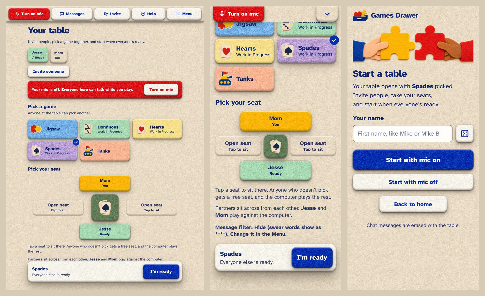

- **Start a table** asks only for your name and the mic. From a game's page (`/spades`) it says
  the table opens with that game picked.
- **Your table** shows who's here (with Invite someone right under them), the mic strip if
  yours is off, the games (anyone picks, or changes the pick), and for Hearts, Spades and
  Dominoes, **Pick your seat**: four seats around a little piece of the green table. Yours is
  sunflower; ready people turn mint; empty seats say "Tap to sit".
- **The strip at the bottom** stays on screen while you scroll: the game, who we're waiting
  for, and **I'm ready** (then **Not ready** to take it back).
- **It starts when everyone here is ready.** Someone who dropped out doesn't hold it up (their
  seat is played for them until they're back). The computer plays empty seats. Seats carry into
  the game, so Spades partners sit across from each other.
- **Picking another game** starts everyone's Ready over. **Switch game** brings everyone back to
  the table, nothing picked. The 1.5-second wait after starting a game is gone: it only
  swallowed taps now that nothing starts without everyone.
- **"Computer" is fine where it's needed** (settled 2026-11-20). The old rule was only about
  not putting the word under a player's name, where it took room. So the seat notes say "the
  computer plays the rest" and "Jesse and Mom play against the computer"; the name tags keep
  just the robot name and the little screen.

---

## 1. Round 2: your notes, done

All of these are in, checked in screenshots at phone, iPad and computer sizes (not on a real
device). 293 unit tests and 47 browser tests pass.

**Your felt art and the way in.**
- **Art:** home has your felt hands-and-puzzle picture and your felt drawer icon by "Games
  Drawer".
- **Game tiles:** they use your first set of felt icons (blue tank with a flag, heart card, spade
  card, domino, red and yellow puzzle). I cut them out of their cream background.
- **Bigger names:** the tiles are now two across with bigger names (22 px, was 18) and bigger
  icons. On phones they stay two across, so the start buttons are still on the first screen.
- **Table code box:** clean white instead of felt.

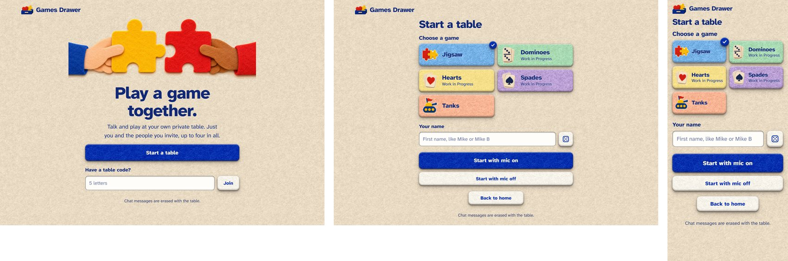

**Names.** Capped at 15 letters, blocked as you type (not cut later). The box says "First name,
like Mike or Mike B".

**Quick drop-and-return is silent.** If someone drops out and is back within 10 seconds (a
reload, a phone waking up), Messages says nothing. If they're gone longer, "Liz left." appears
after 10 seconds, then "Liz is back." when they return. Leaving on purpose (Leave table) still
says so straight away.

**The bar (your modified B).**
- **iPad and computer:** your mic on the left, then Messages, Invite, Help and Menu grouped on
  the right, each with a small icon. Messages no longer sits off on its own.

- **Phones (upright and sideways):** the bar is folded. Your mic stays as a red tab in the
  top-left corner. A caret tab in the top-right corner drops Messages, Invite, Help and Menu down
  as a stack of felt buttons. Using one, or touching the game, folds it again; a red dot on the
  caret means unread messages. Each game keeps its top corners clear for the two tabs.

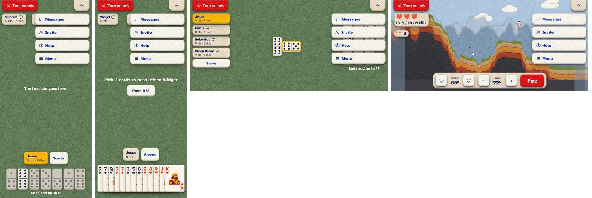

**Jigsaw:** unchanged (gray felt with piece shadows), as you liked it.

**Dominoes: matte ceramic.** A clean warm-white face (no grain or shine), dark pips pressed into
it, a crisp navy middle line, a softly rounded edge and a thick side. Tiles you can't play are a
grayer ceramic with faded pips.

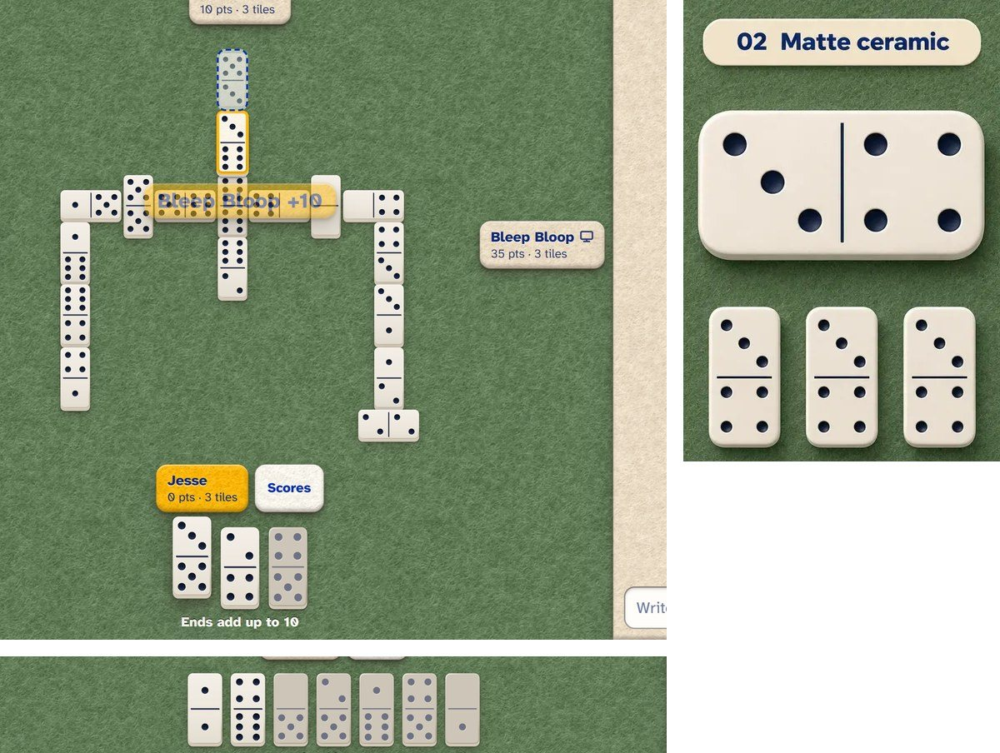

**Tanks.**
- **Controls:** on a phone held sideways, the control strip runs down the right edge (Angle,
  Power, Fire), and the battlefield gets the full height to its left. On iPads and computers it
  stays along the bottom.
- **Sprites:** the tanks, turrets, helicopters, parachutes, hearts (full and lost), windsock and
  clouds are your felt sprite sheet.
- **Tank colors:** each tank's hull and turret take the player's color, and the tracks and
  wheels stay charcoal.

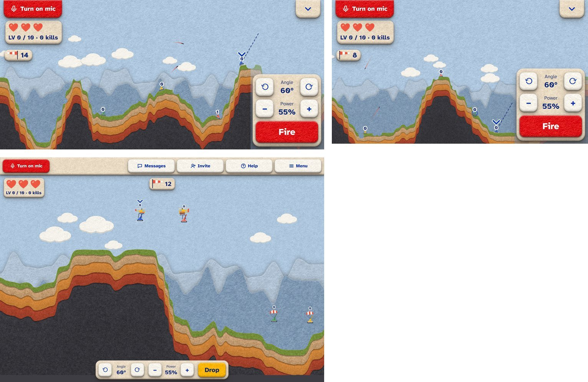
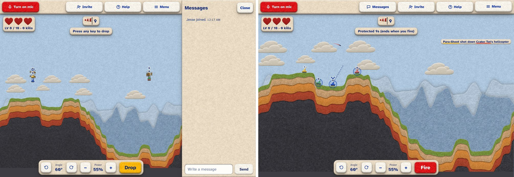
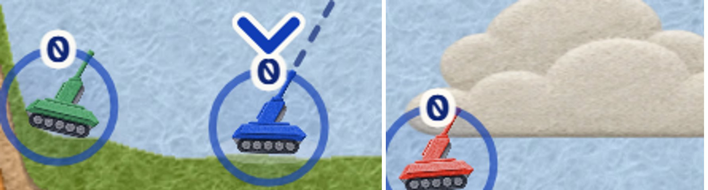

**Tanks stutter: fixed.** It was real and older than felt: the sky's felt texture made Chrome
draw the whole battlefield on the CPU. Measured on a computer: 21–23 frames a second at
1440×900 (and about 10 on a 3840-wide screen) before, a steady 104 after. Jigsaw's felt frame had
the same problem and got the same fix.

**Icons for future games:** your sheet is saved in `scripts/art/future-game-icons.webp`, cut into
nine icons in `scripts/art/future-icons/` (dice, mahjong, two poker ones, bricks, letters, air
hockey, arcade shooter, slots).

**Messages wording:** kept as "Chat messages are erased with the table."

---

## 2. Decisions still open

1. **Your second icon set.** Mid-way through you sent a second set with transparency (green
   tank, aces of hearts and spades, two dominoes, blue and yellow puzzle). It didn't reach me as
   a file, only as a picture in the chat, so the tiles use your first set. Which set do you
   prefer? If it's the second, save it into the project folder (for example
   `scripts/art/felt-icons.png`) and I'll swap it in.
2. **The browser-tab icon** is still the old flat drawer. Should it use the felt drawer?
3. **No-wind windsock.** Your sheet has the windsock blowing left and right but not hanging limp,
   so when there's no wind Tanks still shows the old paper one. A felt "calm" windsock would
   finish the set.
4. **The paper look.** Felt replaced the paper art on this branch (hero, icons, sprites; git
   keeps the old ones). Drop Cut Paper entirely when this merges, or keep it as a switch?

---

## 3. Background: the top bar proposals

**The problem:** the bar takes a full strip at the top of every game: 64 px, about 8% of an
iPad's height and 13% of a phone held sideways. Only the mic button gets used often. Invite,
Help, Menu and Messages matter but get used rarely.

Each proposal is shown on a live Dominoes table. These are CSS-only mockups, not wired up. Top
left is today; then A, B and C.

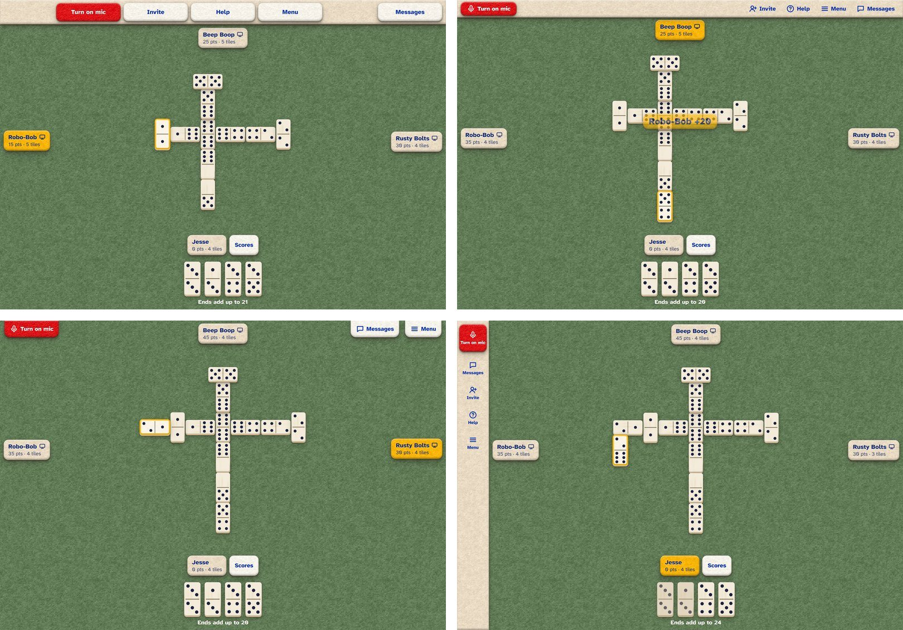
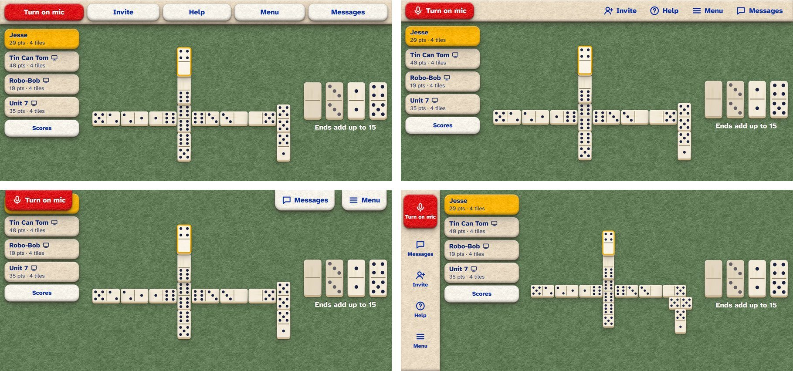

### A. Slim bar (top right in each grid)

Same five things, in a strip two-thirds as tall (46 px). Only the mic stays a felt button; the
rest become small icon-and-word buttons pressed into the strip, grouped at the right.

- **Good:** nothing moves, so nobody has to relearn anything. It saves a third of the height.
- **Not so good:** it's still a full strip. The small words are under our 48 px tap size, so the
  icons would need to be the tap target.

### B. Corner tabs (bottom left)

No bar at all. Your mic hangs as a felt tab from the top-left corner. Messages (with its unread
dot) and Menu hang from the top right. Invite and Help move to the top of the Menu.

- **Good:** the table gets the whole screen. The mic stands alone, so it's the most obvious
  thing on screen, which suits a voice-first site.
- **Not so good:** the corners are shared with the games. On a phone held sideways, the mic tab
  covers your name in Dominoes; Jigsaw's progress tag and Tanks' hearts would need to move too.
  Invite and Help are one more tap away.

### C. Side rail (bottom right)

For screens held sideways (most play): the bar becomes a narrow felt strip down the left edge.
The big mic is at the top, then Messages, Invite, Help and Menu, each an icon with its word. Held
upright, it would switch to B's corner tabs.

- **Good:** a sideways screen has width to spare and is short on height, so this uses the right
  space. Everything stays one tap away, and the mic sits under your left thumb.
- **Not so good:** it's the biggest change. Every game's layout loses 84 px of width on that
  side.

### My recommendation (round 1)

**B, with C's idea for phones held sideways if B's corners get crowded.** The mic is the one
thing people use; it should be big and alone. Everything else can live behind Menu, except
Messages, which needs its own visible spot for the unread dot. B also removes Tanks' special
folding bar: every game would work the same way. The cost is a careful pass on each game's
corners.

---

## 4. Background: what changed in round 1

### The felt itself

- **Felt textures:** every color is generated by `scripts/felt-textures.cjs` and matched to your
  swatch sheet at every scale. In a blind test you preferred ours on about half the colors.
- **Mat (gray):** reworked afterwards as a mix of light and charcoal wools; it was the weakest.

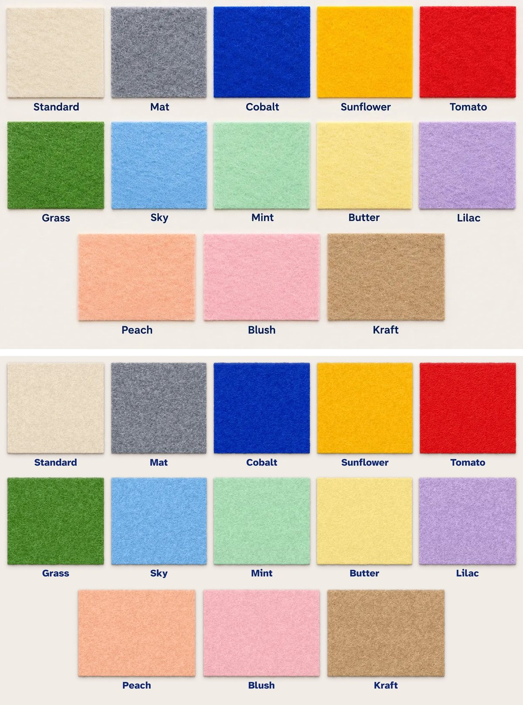
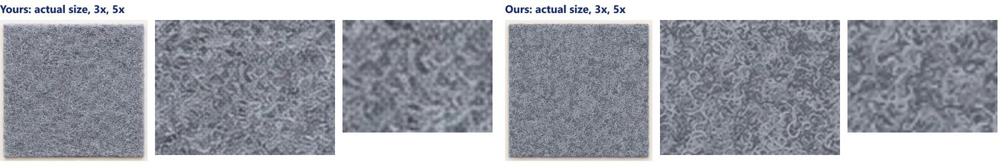

- **Depth:** like your mock. Each piece has a lit top edge and a dark, warm shadow hugging it.
  There are no visible sides and no blue outlines; picked things lift or turn cobalt.
- **Words:** they look pressed into the felt. Words straight on a table are near-white.
- **Boxes you type into:** cut into the felt.
- **Disabled buttons:** plain white felt with soft words.
- **Hover:** on a computer, buttons lift under the pointer.

### The way in, and the Menu

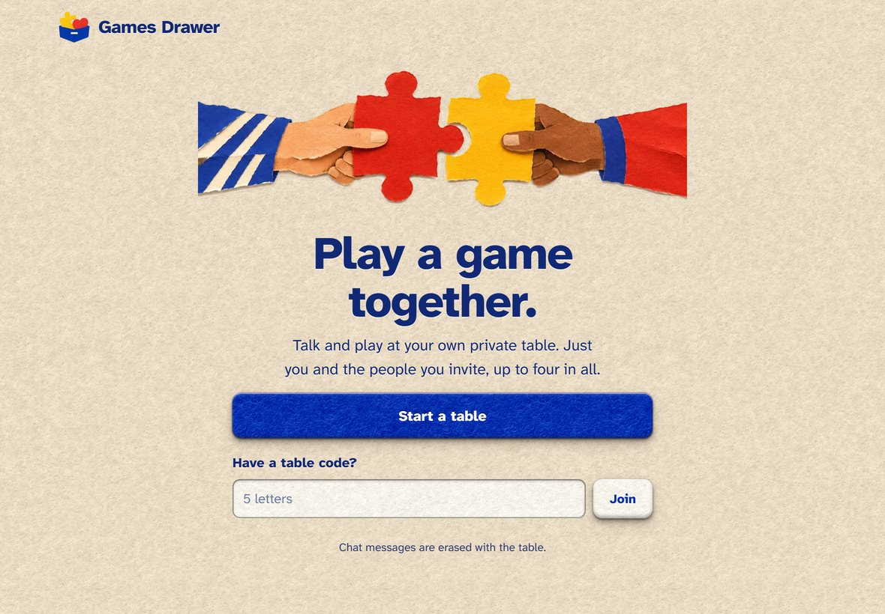
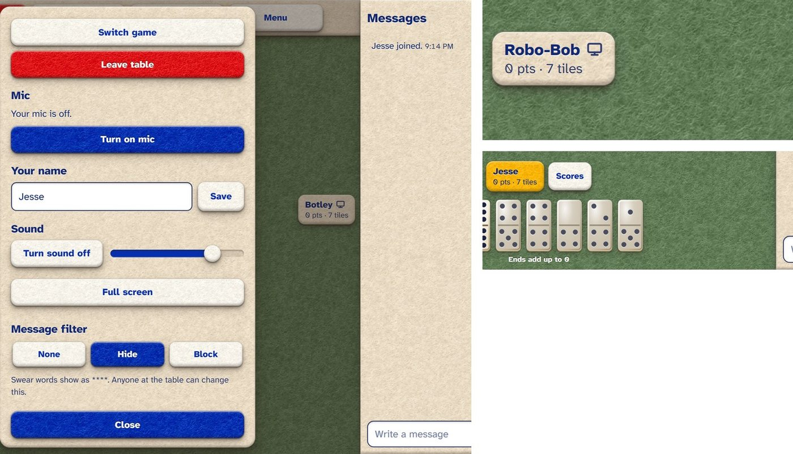

- **Messages:** a cream felt sheet. On an upright iPad it now slides over the table instead of
  squeezing it.
- **Menu:** no divider lines, and the volume slider is felt.
- **Esc on Scores:** it closes Scores instead of stacking the Menu on top.
- **Full screen:** the button says "Exit full screen" while it's full screen.

### Dominoes, Hearts, Spades

All three are on the green card-table felt from your mock.

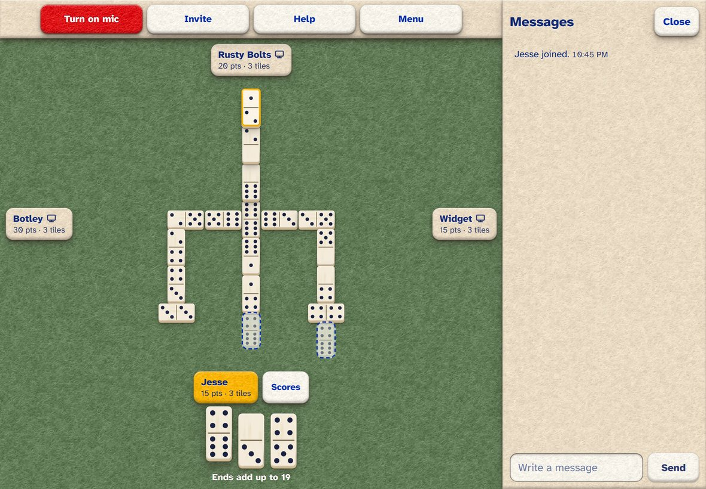
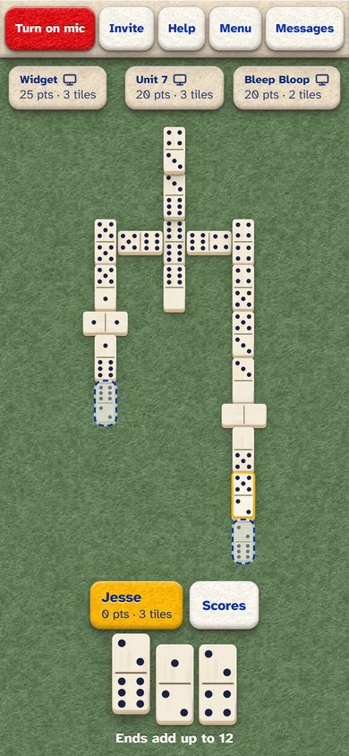
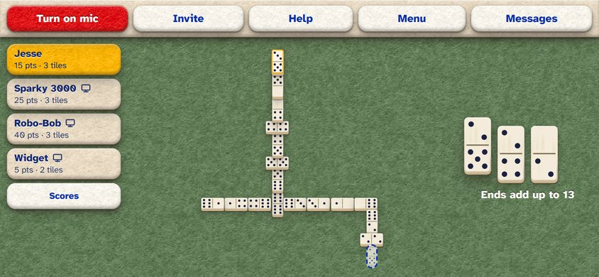
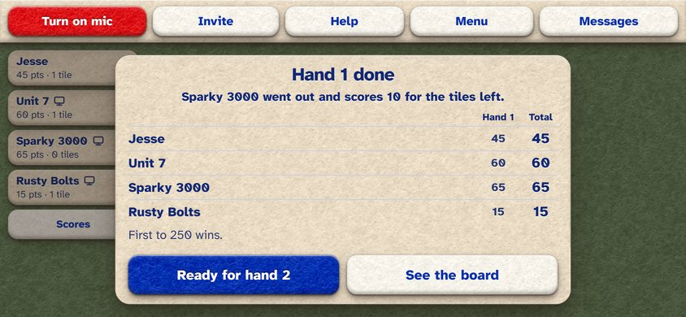

- **Dominoes:**
  - Satin ivory tiles.
  - When you zoom, the cloth zooms with the board.
  - Tiles fade at the board's edge instead of being cut off.
  - If every place for your picked tile is off screen, the board glides to show one.
  - On a sideways phone, the end-of-hand sheet fits all four scores and both buttons.
- **Hearts:** no more card counts on the other players' tags.

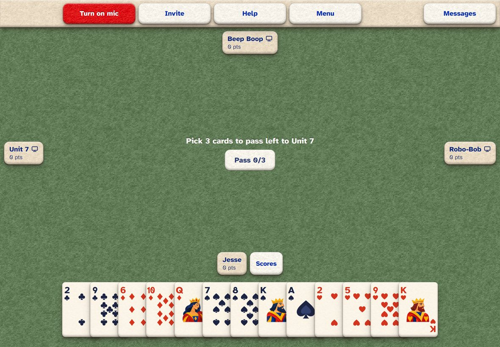
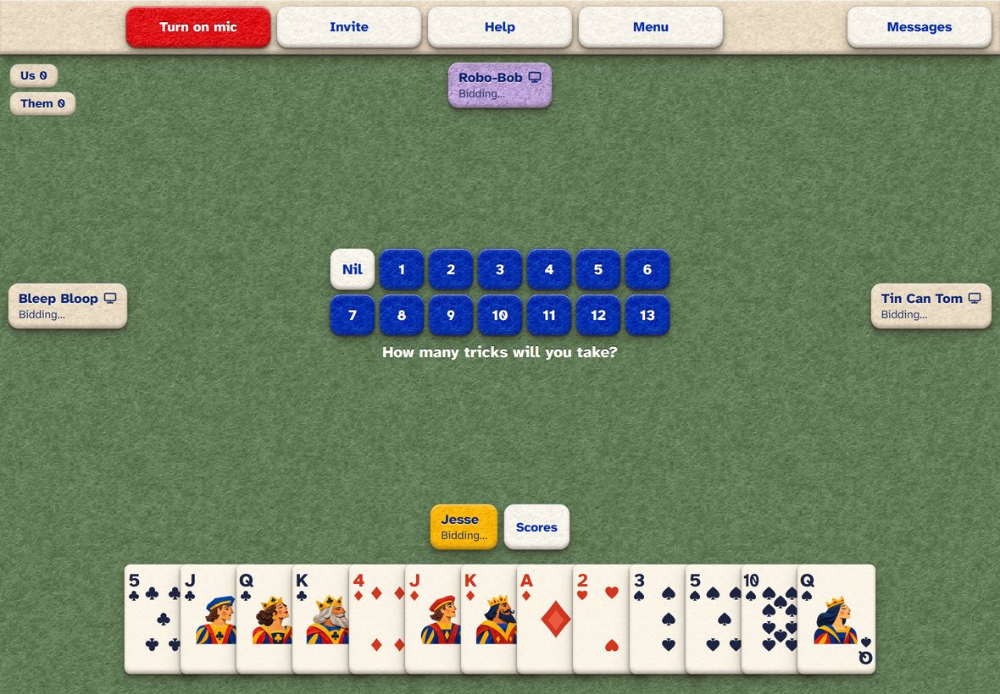

- **Spades:** Us and Them sit in the table's top-left corner, so a played card never covers them,
  and read "Us 0 · 2 of 5 tricks" instead of "2/5".
- **All three:**
  - The middle line says "Liz's turn" instead of "Waiting for Liz…".
  - Your tag and Scores line up again.

### Jigsaw

- **Table:** calm light grey felt.
- **Pieces:** every loose piece casts a small shadow, so light pieces still stand out. Pieces
  locked into the frame lie flat.
- **Frame:** the frame for the finished picture is a sheet of cream felt.
- **Zoom:** the cloth zooms with the puzzle.
- **Resizing:** after resizing or turning the device, it re-fits if you were looking at the
  whole table.
- **Tap sizes:** the tools are 48 px tall.

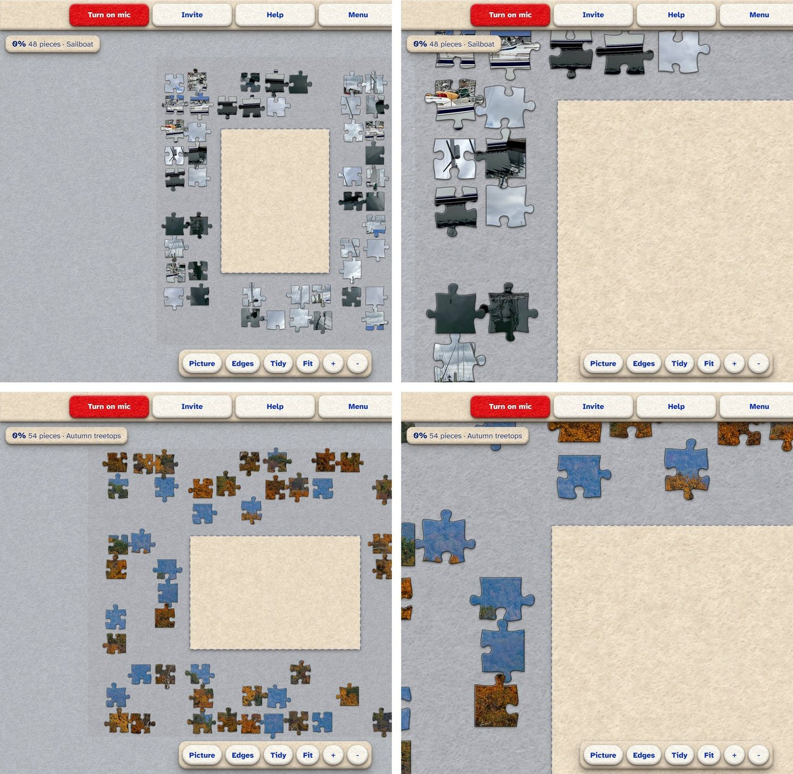

### Tanks

A felt pass from your mock without changing how it plays: same map, same zoom, same HUD tags.

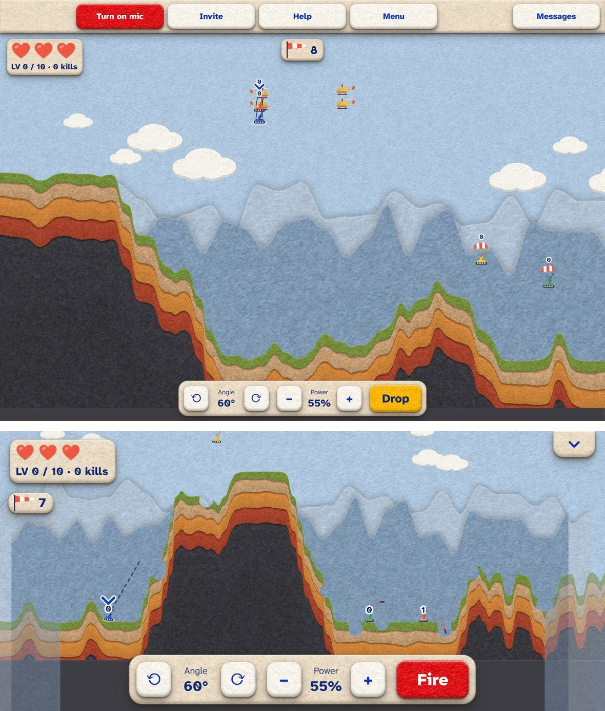

- **Scene:**
  - A muted blue felt sky and slate felt mountains, in place of lilac and mint paper.
  - Ground in layers like the mock: olive grass, then tan, orange and rust over charcoal. The
    edges are cut, not torn, so craters cut cleanly through the layers.
- **Controls:**
  - One compact felt strip along the bottom on every device, like the mock: move (from level 4),
    Angle with its number, Power with its number, then Fire.
  - The separate Angle / Power tag in the top right is gone.
  - The whole battlefield now sits above the strip, so no tank hides under it.
- **Edges:** past the map's edges on wide phones, the hills carry on as a faded mirror instead of
  smeared streaks.
- **Held upright:** the Menu and Messages open on top of the "Turn your phone sideways" card (it
  used to swallow every tap).

**Not done yet:**
- The sprites (tanks, helicopters, parachutes, clouds, windsock) are still the old paper art.
- The lives and wind tags are unchanged.
- The bar still folds away behind a tab on short screens (waiting on section 2).

---

## 5. Testing

Three testers went through the whole site in the felt look, one each on a computer, a phone and
an iPad, at several sizes each. After my fixes a fourth checked the 16 fixes below, and all 16
passed. No browser errors anywhere.

The automated tests pass too: 291 unit tests and 47 browser tests (9 voice tests are skipped, as
before). The browser tests caught two things I'd broken, both now fixed:

- **Unplayable dominoes** were grayed with a CSS filter, which iPad Safari once drew in the wrong
  place. They're recolored now.
- **The felt Jigsaw frame** was fully opaque, which confused how the tests find pieces. It's now
  97% opaque, which looks the same.

1. Tanks held upright: the rotate card blocked the Menu and Messages.
2. Dominoes, sideways phone: "Ready for hand 2" was below the screen.
3. Dominoes zoomed in: tiles were cut off along a hard line.
4. Dominoes zoomed in: your tile's spot could be off screen.
5. Messages: "Report" split into "Repo / rt" and long names wrapped.
6. Upright iPad: Messages squeezed the table.
7. Spades: a played card covered the Us / Them scores.
8. Your tag and Scores didn't line up.
9. Esc on Scores stacked the Menu on top.
10. Join page: a long name split across lines, and "for dominoes" was lowercase.
11. Hearts: "pass left to Bleep / Bloop" split the name.
12. Wording: "Waiting for", "bot" and "lobby".
13. Full screen never said "Exit full screen".
14. Jigsaw didn't re-fit after a resize.
15. Tap sizes: Menu switches, Messages Close, Spades bids and Jigsaw tools are now 48 px.
16. Felt leftovers: flat text boxes, hairlines, hard-to-read disabled buttons, the blue Jigsaw
    frame edge, and the same "doesn't match" note stacking twice.

---

## 6. Still open from testing

Smaller things the testers found that I left, mostly because the top-bar decision changes them:

- **Small text on phones:** some is under 15 px:
  - the bar's words (13.6 px)
  - the top name tags upright (12 px)
  - "Ends add up to" (now 15 px)
  - Spades' small numbers
  - the score sheet's column headings
  - Tanks' Angle and Power labels
- **Upright iPad with Messages open:** the panel covers Help, Menu and the right-hand seat until
  you close it, the same as on phones.
- **Spades:** the right-hand player's played card partly covers yours.
- **Jigsaw:** Tidy once put a loose piece on top of a joined pair.
- **Focus ring:** tapping into a text box shows a thick navy ring. It's needed for keyboard
  users, but could be softer in felt.
- **Disabled Send:** it now reads clearly, but looks almost like a normal button. Worth a look on
  a real device.
- **Messages once closed on its own** during a Hearts hand. It couldn't be reproduced.
- **Not checked:** none of this has been checked on a real iPad or phone, only in a browser at
  those sizes.

---

## 7. Before this merges

- **Rewrite the design rules** (`DESIGN.md`) and the dev sample sheet (`/paper.html`) for felt.
  They still describe Cut Paper.
- **Decide what happens to the paper look.** Felt is a separate stylesheet (`felt.css`) loaded on
  top, so it's easy to drop paper entirely or keep it as a switch.
- **Phone download size:** the felt textures are 60–300 KB each, and a table uses three or four.
  Smaller versions for phones would help the first visit.
- **Commit the `felt` branch,** then merge into main.
